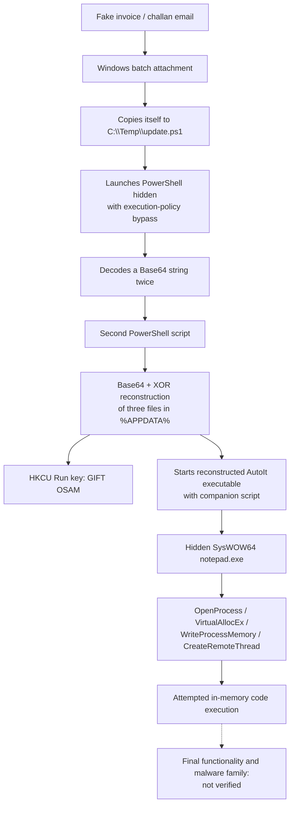

A fake invoice or challan is a convincing piece of social engineering because it asks a recipient to do something ordinary: open a financial document. In this case, the attachment was not a document at all. It contained a Windows batch-and-PowerShell loader whose code was deliberately made difficult to read.

I examined the attachment statically, **without executing it**. This is a case study of what the recovered code supports, where the evidence stops, and how defenders can recognize the same behavior.

> **Scope and confidence:** The obfuscated command, double Base64 wrapper, decoded file-writing logic, startup registry value and AutoIt injection routine are supported by the recovered scripts. The final injected binary was not conclusively attributed to a malware family. XWorm, Donut, credential theft, network endpoints and command-and-control activity are **not claimed as confirmed findings** here. No observed infection is implied.

## 1. The lure: an invoice/challan email

The sender framed the attachment as a financial notice. This attempts to transform a dangerous action—executing an unfamiliar file—into an apparently routine administrative task.

An unexpected ZIP archive is not proof of malware on its own. The decisive red flag is the executable content: a batch file is a **program**, not an invoice or PDF. The recipient had not run the attachment before analysis.

## 2. The execution chain



The arrows show the **intended execution path in the code**. Static inspection cannot prove that each operation would succeed on a real system.

## 3. The batch/PowerShell polyglot

The original file combines batch syntax with PowerShell syntax. Its opening lines include a batch section enclosed within a PowerShell block comment. That enables a copy of the same file to be interpreted differently by `cmd.exe` and by PowerShell.

A few of the random-looking batch assignments amount to individual characters:

```bat
set FWFBZHXFNXZYKWRDHQCANE=e
set TVAHAEQDSKFETSIRZHNBTK=n
set DLXIHQPRLVEHVSYUZSFOEI=d
set FPVLOLUOAWVSUOAKHQUGWS=P
```

Together with mixed capitalization, variable substitution, escaped characters and fragmented strings, the command conceals an invocation equivalent in intent to:

```text
PowerShell.exe -NoProfile -WindowStyle Hidden -ExecutionPolicy Bypass
  -Command "& 'C:\Temp\update.ps1'"
```

This is an execution-policy bypass flag, not a guarantee that Windows security controls are disabled. Nevertheless, the hidden window and deliberate string obfuscation are highly suspicious when delivered as an alleged invoice.

## 4. The huge string is Base64, twice

An enormous PowerShell variable named `$rk5i` contains characters that initially look random. The decoding expression uses `[Convert]::FromBase64String` two times, converts the result to text and ultimately constructs an executable script block using `[ScriptBlock]::Create(...).Invoke()`.

Base64 is **encoding**, not encryption. Nested encoding makes the source harder to inspect quickly, but does not provide real secrecy.

For safe analysis, the correct stopping point is **before** the `.Invoke()`. A non-executing decoder can recover readable script text for review.

## 5. The second script reconstructs three files

The decoded PowerShell references three embedded payloads and reconstructs bytes using Base64 plus simple XOR transformations. The target directory is:

```text
%APPDATA%\SetupFiles
```

Its three output names are:

| Reconstructed file | Apparent purpose |
|---|---|
| `vijewyufveonabghulluonouceyasi.exe` | Windows executable used to launch the next stage |
| `wwmaw` | Companion AutoIt script |
| `Ennnn` | Encoded binary buffer loaded by the script |

The recovered executable has a PE32 header; the companion script contains AutoIt syntax. Signing status and publisher identity should be separately verified before calling an executable *genuine* or *trusted*.

The script also creates a startup entry:

```text
Key:   HKCU\Software\Microsoft\Windows\CurrentVersion\Run
Value: GIFT OSAM
```

This is the clearest evidence of an intent to persist across user logins. It is user-level persistence; the path does not by itself show administrative privileges.

## 6. Why would malware open Notepad?

The companion AutoIt code reconstructs function names from decimal character codes. Those names include:

```text
OpenProcess
VirtualAllocEx
WriteProcessMemory
CreateRemoteThread
CloseHandle
```

Its apparent target is `C:\Windows\SysWOW64\notepad.exe`. The script attempts to launch Notepad invisibly, obtain a handle to that process, allocate memory, copy a decrypted binary buffer into it, and start a remote thread.

This technique is commonly called **process injection**. The intention is to execute code in the context of another process rather than only in the original suspicious launcher.

**Important qualification:** The earlier disassembly appeared to contain 64-bit machine instructions while the targeted `SysWOW64` Notepad is normally 32-bit. That discrepancy is a reason to test the assumptions in an isolated lab, not to assert the injection succeeded.

## 7. What the final binary did—and did not—tell us

After an additional XOR transformation, the binary buffer begins with a relative `CALL` instruction:

```text
E8 C0 A9 00 00
```

This directs control to a later region of the buffer, past a substantial opaque region. The structure is compatible with position-independent loader code and embedded packed or encrypted data.

But a recognizable entry instruction **does not identify the malware family**. A fully verified classification would require reproducible unpacking, disassembly of the recovered inner program, and evidence of its configuration or actions.

In this case, the available analysis **does not establish** credential theft, keylogging, ransomware, XWorm, a specific command-and-control server, or actual data exfiltration.

## 8. So what did the attacker want?

The strongest evidence-backed interpretation is that the sender wanted the recipient to **execute an unwanted loader**, create startup persistence, and run an opaque program while attempting to conceal its execution inside Notepad.

A remote-access trojan or an infostealer would fit that distribution strategy, but those are possibilities rather than findings. A malware analyst should distinguish *capability suggested by the delivery mechanism* from *capability proven in the terminal payload*.

The social-engineering decision was the crucial point: an invoice-themed attachment only becomes an execution chain if somebody runs the program.

## 9. Defensive takeaways

- **Verify financial notices independently.** Navigate directly to the institution's website or app instead of trusting a ZIP, attachment or embedded link.
- **Show file extensions in Windows Explorer.** A `.bat`, `.cmd`, `.ps1` or `.exe` is not a financial document, however it is named.
- **Do not double-click suspicious attachments, even for curiosity.** If analysis is necessary, use a controlled offline or isolated environment and handle unknown files as untrusted.
- **Monitor user-level Run keys.** Investigate unexpected values pointing to executable or script content within `%APPDATA%` and temporary directories.
- **Investigate suspicious process ancestry and memory operations.** In particular, a hidden Notepad launched by an unexpected script interpreter warrants scrutiny.
- **If execution is suspected, disconnect the machine and follow an incident-response process.** Change important credentials using a different known-clean device. A negative antivirus scan alone does not conclusively rule out compromise.

## Indicators useful for local triage

These are on-host indicators visible in the loader; their presence should be investigated in context.

```text
C:\Temp\update.ps1
%APPDATA%\SetupFiles\Ennnn
%APPDATA%\SetupFiles\wwmaw
%APPDATA%\SetupFiles\vijewyufveonabghulluonouceyasi.exe
HKCU\Software\Microsoft\Windows\CurrentVersion\Run  "GIFT OSAM"
C:\Windows\SysWOW64\notepad.exe  (suspicious hidden launch)
```

An extracted executable from this case had SHA-256:

```text
bdd2b7236a110b04c288380ad56e8d7909411da93eed2921301206de0cb0dda1
```

A hash can be searched in a reputation service without uploading the malicious file itself. It is not an attribution verdict.

**MITRE ATT&CK mapping (behavior observed in code):** T1566.001 (phishing attachment, based on the reported delivery), T1059.003 (Windows Command Shell), T1059.001 (PowerShell), T1027 (obfuscation), T1140 (deobfuscation/decoding), T1547.001 (registry Run key), and T1055 (attempted process injection).

---

The useful lesson isn't that a fake invoice can contain impressive obfuscation. It's that no amount of obfuscation helps an attacker if the recipient recognizes that a document has unexpectedly become a program.

*ADB · E-HAX DTU*
